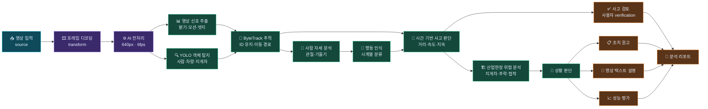

# VisionFlow Studio 파이프라인 흐름도

16개 노드 · 20개 연결 · 위상 정렬 기반 자동 레이아웃 (겹침 0건)

## 전체 흐름

## 레이어 구분

| 레이어 | 노드 | 역할 |
|---|---|---|
| 입력·전처리 | 영상 입력 → 프레임 디코딩 → AI 전처리 | 원본 유지, AI용 640·6fps 축소 |
| 탐지·추적 | 신호 추출, YOLO 탐지 → ByteTrack → 자세 | 객체 감지 + ID 유지 + 관절 분석 |
| 사고·행동 분석 | 행동 인식, 시간 기반 사고 판단 → 산업현장 위험 → 상황 판단 | 룰+시간적 근거 기반 판정 |
| 검토·출력 | 사고 검토, 조치·설명·성능 → 리포트 | 사용자 검증 후 결과 산출 |

## 자동 레이아웃 규칙

- 위상 정렬로 각 노드의 **깊이(열)** 계산
- 같은 깊이의 노드는 **198px 간격 행**으로 배치
- 캔버스 2280×820, 노드 178×104 → 겹침 불가
- 노드 추가/삭제/연결 변경 시 `updateGraph()`가 자동 재배치 + 버전 증가

## 상세 데이터 출력

노드에 마우스를 올리면 다음이 표시됩니다:
- 노드 설명 / 종류
- 입력·출력 건수 (실제 분석 결과 연동)
- 실행 상태·진행률·지연 시간
- 처리량 아이콘 (BarChart3 / Activity)
